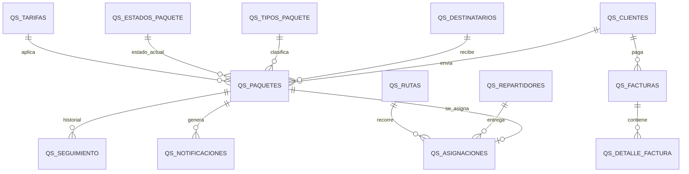

# QuickSend · Base de datos Oracle

Base de datos empresarial para **QuickSend**, un sistema de gestión logística de paquetería: registro de envíos, seguimiento, asignación de repartidores y rutas, facturación y auditoría.

**Autores:** Sebastián Gil · Valery Liñán

## ¿Qué incluye?

Un único script (`quicksend.sql`) que crea el esquema completo y lo llena con datos de ejemplo:

| Elemento | Cantidad | Ejemplos |
|---|---|---|
| Tablas | 18 | `QS_PAQUETES`, `QS_CLIENTES`, `QS_SEGUIMIENTO`, `QS_FACTURAS` |
| Secuencias | 18 | una por tabla |
| Índices | 15 | por cliente, estado, fecha, repartidor |
| Triggers | 12 | auto-PK, auditoría, bloqueo de usuarios |
| Vistas | 5 | `VW_PAQUETES_ACTIVOS`, `VW_KPI_DIARIOS` |
| Procedimientos | 3 | registrar paquete, cambiar estado, generar factura |
| Funciones | 4 | `FN_NOMBRE_CLIENTE`, `FN_DIAS_HABILES` |

## Modelo de datos

Las tablas se organizan en cinco grupos:

- **Catálogos:** estados y tipos de paquete, tipos de documento, ciudades, tarifas
- **Negocio:** clientes, destinatarios, paquetes, seguimiento
- **Operación logística:** vehículos, repartidores, rutas, asignaciones
- **Finanzas:** facturas y detalle de factura
- **Comunicación y auditoría:** notificaciones, usuarios del sistema, auditoría

*(Diagrama simplificado con las relaciones principales.)*

## Características destacadas

- **Integridad de datos:** claves primarias y foráneas, restricciones `UNIQUE` y `CHECK`, incluida validación de correos con expresiones regulares.
- **Automatización con triggers:** generación de IDs, códigos legibles de paquete (`QS-AAAA-NNNNNN`) y de factura, normalización de textos y registro automático del historial de seguimiento.
- **Auditoría:** registro de inserciones, modificaciones y eliminaciones sobre clientes.
- **Seguridad:** bloqueo automático de usuarios tras 5 intentos fallidos; contraseñas almacenadas como hash con salt.
- **Reglas de negocio en PL/SQL:** cálculo de tarifa por peso con IVA del 19 %, validación de peso máximo por tipo de paquete y bloqueo de cambios sobre estados finales.
- **Vistas de negocio:** paquetes activos, carga de repartidores, resumen financiero por cliente y KPIs diarios.

## Procedimientos y funciones

| Nombre | Qué hace |
|---|---|
| `SP_REGISTRAR_PAQUETE` | Valida peso y tarifa, calcula el costo, crea el paquete y su primer evento de seguimiento |
| `SP_CAMBIAR_ESTADO_PAQUETE` | Cambia el estado, registra ubicación y crea una notificación para el cliente |
| `SP_GENERAR_FACTURA` | Genera la factura y su detalle a partir de un paquete |
| `FN_NOMBRE_CLIENTE` | Devuelve el nombre completo (persona natural o razón social) |
| `FN_DIAS_HABILES` | Calcula días hábiles entre dos fechas |
| `FN_HISTORIAL_PAQUETE` | Devuelve el historial de un paquete como texto |
| `FN_PUEDE_CAMBIAR_ESTADO` | Verifica si un paquete puede pasar a un nuevo estado |

## Cómo ejecutarlo

El script está adaptado para **[Oracle FreeSQL](https://freesql.com)** / Live SQL, así que no necesitas instalar nada:

1. Abre el SQL Worksheet.
2. Pega todo el contenido de `quicksend.sql`.
3. Haz clic en **Run Script**.

También funciona en Oracle 19c/21c con SQL Developer o SQL*Plus.

> **Nota:** la sección de roles y permisos está comentada porque requiere privilegios de DBA. En un entorno Oracle propio, ejecútala como administrador.

## Datos de ejemplo y consultas

El script termina con datos de prueba (clientes, destinatarios, repartidores, rutas y paquetes) y diez consultas útiles: rastreo de paquetes, paquetes retrasados, rendimiento de repartidores, ingresos por mes, auditoría y más.

## Tecnologías

Oracle Database 19c/21c · SQL · PL/SQL
